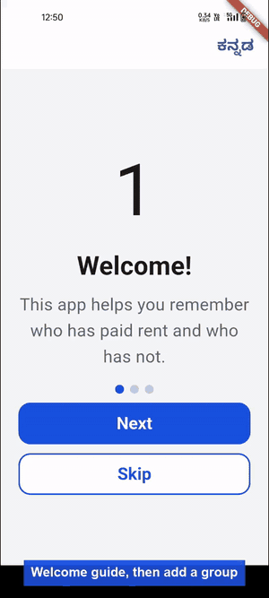

# Tenant Tracker (Rent Book)

A Flutter app for rental property owners to track monthly rent. Add tenants, record payments, and see at a glance who has paid, who is late and how much is still to collect. Android only. All data stays on the device.

## Demo



[Watch the full-quality video](docs/demo.mp4): the Welcome guide, adding a group and a tenant, and recording a part and a full payment. The scripts that record it are in [scripts/demo](scripts/demo/README.md).

## Features

- **Tenants**: each has a name, rent amount, due day (default 10) and start month. Monthly records are generated on demand for every month from the start month.
- **Groups**: organise tenants into groups such as "Block A". Home shows one card per group with its tenant count, most urgent status and the money still to receive this month. Existing tenants sit in a built-in **Uncategorized** group.
- **Monthly status** for every month: Pending, Completed, Late Completed, Partial, Partial Overdue, Overdue, Backlog and Backlog Cleared. Each month's shortfall stays a separate debt and doesn't roll into the next month.
- **Payments**: recorded individually with their date. You can edit a payment's amount or date later, and the month's status and balance update by themselves. Undo removes a payment you just recorded.
- **Rent changes**: increase or decrease a tenant's rent from the next month onwards. Past months and backlog keep their original amount, because rent history is stored.
- **Archive**: deleting a tenant archives them. Their history is kept and is read-only under Settings > Archived.
- **History**: fully paid months move to History, and Tenant Detail says "No pending due" when nothing is owed.
- **Languages**: English and Kannada.

See [RELEASE_NOTES.md](RELEASE_NOTES.md) and [CHANGELOG.md](CHANGELOG.md) for what changed in each version. The current version is 2.0.0.

## Tech stack

- Flutter (Android only, portrait)
- [`drift`](https://pub.dev/packages/drift) and `drift_flutter` for local SQLite storage
- `shared_preferences`, `intl` and Flutter localization (`l10n.yaml`)
- `uuid`

The code is layered: `lib/core`, `lib/data`, `lib/domain` and `lib/features`.

## Getting started

Requirements: the Flutter SDK and an Android device or emulator.

```bash
git clone https://github.com/RanjanKiran707/tenant_tracker.git
cd tenant_tracker
flutter pub get
dart run build_runner build   # generates the drift database code
flutter run
```

Run the tests with `flutter test`.

## Known limits

- Overpayment isn't carried forward to the next month.
- Archived tenants can't be restored.
- A payment can be edited but not deleted. Undo right after recording is the only way to remove one.
- No cloud backup yet. Uninstalling the app removes your data.

## Docs

- [Product specs](project_spec/specs.md)
- [Data model](project_spec/data_model_tenant_tracker.md) and [ERD](project_spec/erd_tenant_tracker.md)
- [Dependency analysis](project_spec/analysis_of_dependencies.md)
