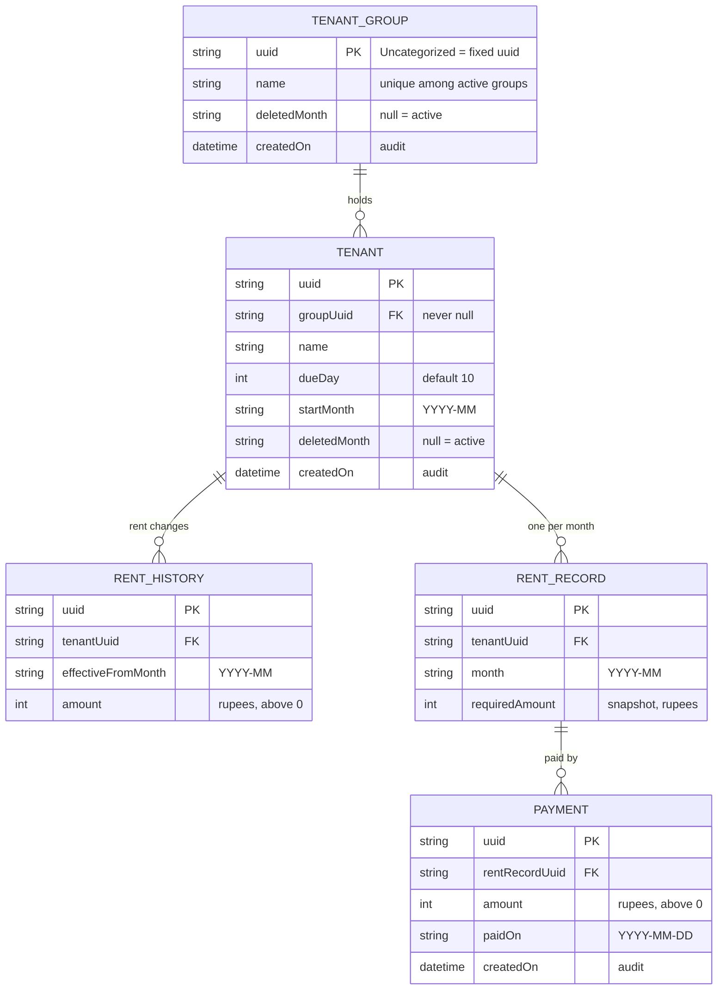

# Tenant Tracker – ERD

Picture of the five database tables and how they connect. Field rules are in `data_model_tenant_tracker.md`. The code is in `lib/data/database/tables.dart`.

## How to read it

- A **group** holds many **tenants**; a tenant is in exactly one group. Tenants from before groups existed were put in the built-in **Uncategorized** group when the app was updated.
- One **tenant** has many **rent changes** (RENT_HISTORY) and many **monthly records** (RENT_RECORD, one per month).
- A **payment** belongs to one monthly record. It can pay an older month, so a month can have several payments.
- RENT_HISTORY is unique per `(tenantUuid, effectiveFromMonth)`: a second change in the same month replaces the first.
- RENT_RECORD is unique per `(tenantUuid, month)`. `requiredAmount` is a snapshot, so a later rent change does not alter past months.
- Status, paid total, balance and old dues are **not stored**. They are worked out from the records, the payments and today's date. The same goes for a group's tenant count, urgent status and money to receive.
- Nothing is hard-deleted. Deleting a tenant or a group sets `deletedMonth`; the rows stay. A group can only be deleted when it has no active tenants. Only a payment can be removed, for the immediate Undo.

## Not in the database

Settings (language, show tips, seen welcome) are in `shared_preferences`. The default due day (10) is a constant.
